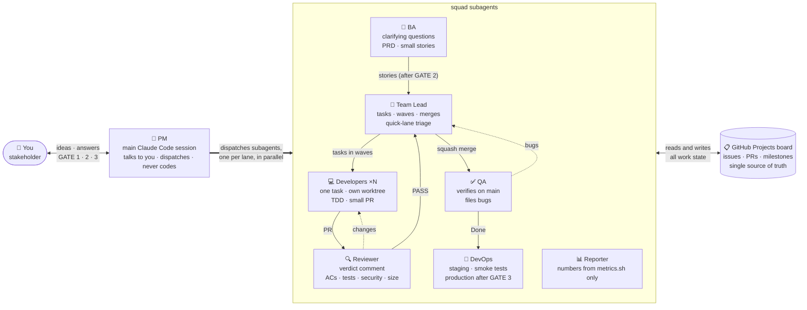

# agile-squad

**English** · [Tiếng Việt](README.vi.md)

A software team for Claude Code. You talk to one PM, and the PM runs a team of subagents: BA,
Team Lead, Developers, Reviewer, QA, DevOps and Reporter. The team coordinates through a
GitHub Projects board. Every requirement, task, PR, bug and release lives on GitHub, so you
can follow the work there or just ask the PM.

```
/plugin marketplace add congdang-agilityio/agile-squad
/plugin install squad@agile-squad
```

## Who does what



| Role | Runs as | Does | Never does |
|---|---|---|---|
| **PM** | the main session | talks to you in your language, runs `/squad:run`, dispatches subagents, relays gates and questions | write code, review, test, merge, approve a gate for you |
| **BA** | `squad:ba-analyst` | reads your sources, asks clarifying questions until the requirement is clear, writes the PRD and small Given/When/Then stories | answer for you, choose technology |
| **Team Lead** | `squad:team-lead` | splits stories into XS/S/M tasks with dependencies and parallel waves, triages `/squad:fix` requests, does the final check and squash-merges | edit code, change acceptance criteria |
| **Developers** | `squad:developer` (×N) | one task each in its own git worktree, port and test database; TDD; one small PR | push to `main`, work outside the task or the worktree |
| **Reviewer** | `squad:reviewer` | checks the PR against the acceptance criteria, tests, security and size; posts `Verdict: PASS` or `CHANGES` | edit code, approve or merge |
| **QA** | `squad:qa-tester` | verifies every criterion on the latest `main` with the full suites and the running app; files bugs as sub-issues | fix code, weaken a criterion |
| **DevOps** | `squad:devops` | release notes, staging deploy and smoke tests, production after your approval, rollback path on failure | deploy from a laptop, touch secrets, approve production |
| **Reporter** | `squad:reporter` | progress reports where every number comes from `metrics.sh` | estimate or invent numbers |

## What you get

- **Requirements to stories.** The BA asks questions until the requirement is clear. You sign
  it off (GATE 1), then approve small Given/When/Then stories (GATE 2).
- **Small tasks in parallel.** The Team Lead splits stories into XS/S/M tasks with expected
  files, dependencies and a Definition of Done. `waves.sh` computes waves, so independent
  tasks run in parallel. Each developer works in its own git worktree, port and test database.
- **Real review and QA.** Every PR is reviewed against the acceptance criteria, security and
  size limits. QA verifies every item on the latest `main` with the full suites and the
  running app, and files bugs as sub-issues.
- **Gated releases.** DevOps deploys a milestone to staging through GitHub Actions and smoke
  tests it. The production job then waits for your approval in the GitHub Environment
  (GATE 3).
- **A quick lane for small changes.** `/squad:fix "<what>"` turns one small request into one
  task and runs it through dev, review, merge and QA, without the BA and story gates.
- **Cost control.** Small tasks run on cheaper models (config `models`), and each run stops
  at a token budget.
- **Guard rails in code.** A hook blocks pushes to `main`, `--admin` merges and self-approvals,
  and keeps each role's file writes in its lane (developers only in their worktree).
- **Honest reports.** Every number in a report comes from `metrics.sh`, never from the model.

## Requirements

- Claude Code with plugin support.
- `gh` (GitHub CLI) logged in, with the `project` and `workflow` scopes:
  `gh auth refresh -h github.com -s project,workflow`.
- `git`, `jq`, `python3`, `awk` and **bash 4+** (macOS ships bash 3.2: `brew install bash`).
- Optional, for requirement files: `pdftotext` (poppler) and `pandoc` or `markitdown`
  (`ingest.sh` has a built-in fallback for .docx/.pptx/.xlsx).
- The target project's own toolchain (for example Node and Docker for a local test database).
- For deploys: a hosting platform reachable from GitHub Actions. The template uses Railway with
  one project token per environment, stored as a GitHub Environment secret by you.

## Installation

**From the marketplace:**

```
/plugin marketplace add congdang-agilityio/agile-squad
/plugin install squad@agile-squad
```

**From a folder** (for trying it out or developing it):

```bash
claude --plugin-dir /path/to/agile-squad/squad
```

Skills appear as `/squad:<name>` and agents as `squad:<name>`.

## First run in a repository

Open Claude Code in a clone of the target repository (it needs a GitHub remote) and run
`/squad:setup`.

Just trying squad? `/squad:setup quick` creates the board, labels and commands in about two
minutes, with deploys off (`deploy.platform: none`); run `/squad:setup` later to add them.

Setup does the following:
- creates or reuses the GitHub Projects board, with the Status columns
  `Backlog → Todo → In Progress → In Review → QA → Done → Released` and the Priority, Size,
  Wave, Agent and Attempts fields;
- creates the labels and writes `.squad/config.yml`;
- turns on squash merges and branch protection on `main` (nobody pushes to `main`, admins
  included);
- adds the deploy workflow and creates the `staging` and `production` GitHub Environments,
  with you as the required reviewer of production;
- ends with `/squad:doctor`, which checks all of the above and proposes fixes.

Fill in the `commands` section (install, test, lint, e2e, build, start, services) in the
config. In an empty repository, also set `stack`, or let the Team Lead propose one for you.

Claude Code's auto mode blocks `gh pr merge`. Setup offers the allow rule
`Bash(gh pr merge:*)`, so the Team Lead can merge PRs that passed review.

## Day-to-day workflow

| You want to | Say or run |
|---|---|
| Start a feature or product | Describe it, or attach files and links, then `/squad:ba` |
| Fix or tweak something small | `/squad:fix "<what to change>"` (one XS/S task, no story) |
| Answer the BA's questions | Answer in chat; the PM relays them and records the answers |
| Approve requirements / stories | Reply to GATE 1 / GATE 2 in chat |
| Let the team work | `/squad:run scope=#<epic or stories> [max-steps=N] [max-tokens=N]` |
| Release finished stories | Give the PM a milestone title when it asks (`v0.3.0 login`) |
| Approve production | Approve the waiting `production` job on GitHub (GATE 3) |
| Know where things are | `/squad:report` or ask "how is it going?" |
| Check the setup | `/squad:doctor` |

`/squad:run` is the PM loop. Each step it reads the board with `next.sh` and dispatches one
action per lane in one message: deploy, QA, PR review or merge, rebase, planning, plus
developers up to the free slots. It reads each result and repeats. It stops when:
- it needs you (a requirements question, GATE 1 or GATE 2);
- only GATE 3 is left (while GATE 3 is pending, the other lanes keep working);
- it reaches `max-steps` or the token budget;
- nothing is left to do (it then runs the report).

Run it again to continue; the board is the state, nothing lives in the session.

Individual skills can also be called directly, for example `/squad:dev 42`,
`/squad:review 57`, `/squad:qa 42` or `/squad:deploy "v0.3.0 login"`. Each one dispatches its
subagent instead of doing the work in the main session.

### Gates

| Gate | When | How you answer |
|---|---|---|
| GATE 1 | Requirements are clear | Sign-off in chat (recorded in `docs/requirements/<slug>/`) |
| GATE 2 | Stories are drafted | Approve or comment in chat; then the epic and stories are created |
| GATE 3 | Staging passed smoke tests | Approve or reject the `production` job on GitHub |

The team never approves a gate for you, and it never treats silence as approval.

## Configuration (`.squad/config.yml`)

| Key | Meaning |
|---|---|
| `commands.*` | install, test, lint, e2e, build and start (QA runs the app on `$PORT`), and an idempotent `services` command (e.g. start a test Postgres) |
| `parallel.max_parallel_dev` | developer slots (worktrees), default 2 |
| `parallel.max_open_prs` | no new developers while this many PRs wait for review |
| `parallel.max_agents` | subagents dispatched at once by the run loop (memory), default 3 |
| `parallel.port_base`, `test_db_prefix`, `database_url_template` | per-slot port and test database |
| `merge.require_ci` | merge only with green CI |
| `models.<role>` | model per dispatch (`sonnet`, `opus`, `haiku`) for dev, review, qa (by task size `XS`/`S`/`M`, QA also `story`), rebase, merge, deploy, and `quick` (the Team Lead's `/squad:fix` decision) |
| `budget.max_tokens_per_run` | `/squad:run` stops dispatching once its subagents reported this many tokens (approximate; default 2,000,000) |
| `deploy.*` | `platform` (`railway` or `none`), workflow names, staging and production URLs, production environment |
| `limits.*` | attempts before `needs-human`, story size, PR line/file limits per task size, files excluded from the size check |

The `ids` block is written by setup; do not edit it by hand. If it is incomplete, run
`board.sh bootstrap --project <n>` again (or `/squad:doctor`).

## Guard rails

`hooks/hooks.json` runs `scripts/guard.sh` before every Bash, Write and Edit call, in
repositories that have `.squad/config.yml` (elsewhere it does nothing):

| Who | Blocked |
|---|---|
| everyone | `git push` to `main`/`master` (also a bare push from `main`), `gh pr merge --admin`, `gh pr review --approve` |
| Developers | writing files outside `.worktrees/<issue>/` |
| BA | writing outside `docs/requirements/` |
| Reporter | writing outside `.squad/reports/` |
| Reviewer, QA, Team Lead, DevOps | writing or editing any file |

The main session is not restricted beyond the first row, so you can still work in it yourself.

## Troubleshooting

Start with `/squad:doctor`: it detects most of these and prints the fix.

| Symptom | Cause and fix |
|---|---|
| `config value .ids.… is missing` | The config lost its board ids. Run `board.sh bootstrap --project <n>`; it reuses the board |
| `gh: … requires the project scope` | `gh auth refresh -h github.com -s project,workflow` |
| Tasks jump to Done right after merge, skipping QA | A built-in project workflow ("Item closed") sets Status. Run `board.sh workflows --fix` (deletes it) |
| `gh pr merge` is blocked in auto mode | Add the allow rule `Bash(gh pr merge:*)` (setup offers it) |
| `squad guard: …` | The guard hook blocked a rule-breaking call; the message says what to do instead |
| A PR is labeled `needs-split` | It is bigger than its task size. The Team Lead re-sizes or splits it. Add generated files (lock files, migration locks) to `limits.pr_size_exclude` |
| An item is labeled `needs-human` | It failed `limits.max_attempts` times. Read its last comment, decide, then remove the label |
| An item is labeled `blocked` | It waits for your answer. The PM removes the label after recording your answer |
| Done stories never deploy | They are in no milestone. Give the PM a milestone title (`next.sh` lists them as `unreleased`) |
| Staging smoke test fails | DevOps files a P0 bug with logs and the rollback path; production is not touched |
| Two developers never run at once | Their tasks depend on each other or are serial (migrations, shared routing, config). That is intended |

Scripts can be run by hand from the repository root for diagnosis. Each one prints its usage
with `--help`: `next.sh` (what the PM would do now), `board.sh list <status>`, `waves.sh`,
`pr-size.sh <pr>`, `release.sh gate "<milestone>"`, `metrics.sh --since <date>`, `doctor.sh`.

## Repository layout

```
.claude-plugin/marketplace.json   marketplace entry (agile-squad)
squad/                            the plugin
├── .claude-plugin/plugin.json
├── skills/      setup, doctor, ba, fix, plan, dev, review, qa, deploy, report, run
├── agents/      ba-analyst, team-lead, developer, reviewer, qa-tester, devops, reporter
├── hooks/       hooks.json (guard)
├── references/  conventions per role, result statuses per role, templates, review checklist
├── scripts/     board, issue, worktree, waves, pr, pr-size, release, metrics, next, ingest, doctor, guard
├── templates/   squad.config.yml, deploy.yml (GitHub Actions → Railway)
└── evals/       behavior evals (claude plugin eval)
tests/                            script tests (tests/run.sh) and model comparisons
docs/                             design decisions and test logs of every build phase
```

## Development

- `tests/run.sh`: script tests with a fake `gh` (no network). CI runs them on Linux and macOS
  together with shellcheck and `claude plugin validate`.
- `cd squad && claude plugin eval . --scaffold --ablation none --runs 2 --max-cost-usd 10`:
  behavior evals (costs API credits; also available as the manual `evals` workflow).
- `tests/model-eval/quick-mode/`: how the model for a role was chosen, reproducible.
- [CHANGELOG.md](CHANGELOG.md), [design decisions](docs/decisions.md),
  [test logs](docs/squad-tests/).

## Limits

- GitHub Projects only. Trello and Jira are not supported yet; the scripts are the adapter
  layer.
- One reviewer and one QA at a time.
- No automatic production rollback. The P0 bug names the previous tag to redeploy.
- The token budget counts what subagents report; it is a guard, not a bill. For a hard dollar
  cap on unattended runs use `claude -p --max-budget-usd <n> "/squad:run …"`.
- DevOps has no access to the hosting platform: databases, platform settings and logs are
  set up or fetched by you.
- One GitHub account for all roles. Reviews are verdict comments (GitHub does not let an
  account approve its own PR), and the Team Lead merges.
- Tested end to end on one Node/Next.js project; listings are capped (projects 100, open PRs
  200, issues 500).

## License

MIT, see [LICENSE](LICENSE).
