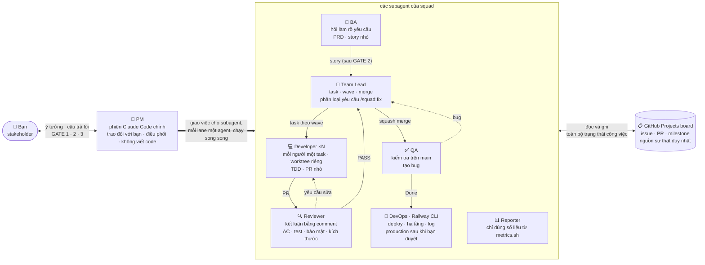

# agile-squad

[English](README.md) · **Tiếng Việt**

Một đội phát triển phần mềm chạy trong Claude Code. Bạn chỉ làm việc với một PM, còn PM điều
phối một nhóm subagent: BA, Team Lead, Developer, Reviewer, QA, DevOps và Reporter. Cả đội phối
hợp qua một GitHub Projects board. Mọi yêu cầu, task, PR, bug và bản phát hành đều nằm trên
GitHub, nên bạn theo dõi trực tiếp ở đó hoặc chỉ cần hỏi PM.

```
/plugin marketplace add congdang-agilityio/agile-squad
/plugin install squad@agile-squad
```

## Ai làm gì



| Vai trò | Chạy dưới dạng | Làm gì | Không bao giờ |
|---|---|---|---|
| **PM** | phiên chính | trao đổi với bạn bằng ngôn ngữ của bạn, chạy `/squad:run`, giao việc cho subagent, chuyển các gate và câu hỏi tới bạn | viết code, review, test, merge, tự duyệt gate thay bạn |
| **BA** | `squad:ba-analyst` | đọc tài liệu nguồn, hỏi làm rõ cho đến khi yêu cầu rõ ràng, viết PRD và các story nhỏ dạng Given/When/Then | trả lời thay bạn, chọn công nghệ |
| **Team Lead** | `squad:team-lead` | chia story thành task XS/S/M kèm phụ thuộc và các wave chạy song song, phân loại yêu cầu `/squad:fix`, kiểm tra lần cuối rồi squash-merge | sửa code, đổi tiêu chí chấp nhận |
| **Developer** | `squad:developer` (×N) | mỗi người một task trong git worktree, port và database test riêng; làm theo TDD; một PR nhỏ | push lên `main`, làm ngoài phạm vi task hoặc ngoài worktree |
| **Reviewer** | `squad:reviewer` | đối chiếu PR với tiêu chí chấp nhận, test, bảo mật và kích thước; đăng `Verdict: PASS` hoặc `CHANGES` | sửa code, approve hay merge |
| **QA** | `squad:qa-tester` | kiểm tra từng tiêu chí trên `main` mới nhất bằng toàn bộ bộ test và ứng dụng đang chạy; tạo bug dạng sub-issue | sửa code, nới lỏng tiêu chí |
| **DevOps** | `squad:devops` | vận hành Railway bằng CLI dưới chính phiên `railway login` của bạn: deploy staging và (sau GATE 3) production, smoke test, database, biến môi trường và cài đặt service (infra task), đọc log, rollback sau khi bạn đồng ý | xem hay đặt secret, đổi production khi chưa được bạn duyệt, tự duyệt GATE 3 |
| **Reporter** | `squad:reporter` | báo cáo tiến độ, mọi con số lấy từ `metrics.sh` | ước lượng hay bịa số liệu |

## Bạn nhận được gì

- **Từ yêu cầu đến story.** BA đặt câu hỏi cho đến khi yêu cầu rõ ràng. Bạn ký duyệt yêu cầu
  (GATE 1), sau đó duyệt các story nhỏ dạng Given/When/Then (GATE 2).
- **Task nhỏ, chạy song song.** Team Lead chia story thành task XS/S/M, mỗi task có danh sách
  file dự kiến, phụ thuộc và Definition of Done. `waves.sh` tính các wave để những task độc
  lập chạy song song. Mỗi developer làm trong git worktree, port và database test riêng.
- **Review và QA thật sự.** Mọi PR đều được review theo tiêu chí chấp nhận, bảo mật và giới
  hạn kích thước. QA kiểm tra từng hạng mục trên `main` mới nhất bằng toàn bộ bộ test và ứng
  dụng đang chạy, rồi tạo bug dạng sub-issue.
- **Phát hành có kiểm soát.** DevOps deploy một milestone lên staging bằng Railway CLI và chạy
  smoke test. Production chờ bạn duyệt trong một GitHub Environment (GATE 3); sau đó DevOps
  deploy đúng commit đã qua staging.
- **DevOps vận hành được nền tảng.** Database, biến môi trường, cài đặt service (ví dụ lệnh
  migration chạy trước khi deploy) và log do DevOps xử lý dưới dạng `infra` task: staging tự
  làm, production chỉ làm sau khi bạn đồng ý rõ ràng. Không có Railway token nào được lưu ở
  đâu cả: CLI dùng chính phiên đăng nhập của bạn.
- **Lane nhanh cho thay đổi nhỏ.** `/squad:fix "<nội dung>"` biến một yêu cầu nhỏ thành một
  task, chạy qua dev, review, merge và QA, không cần BA và các gate về story.
- **Kiểm soát chi phí.** Mỗi task chạy bằng model rẻ nhất mà độ phức tạp của nó cho phép, chỉ
  lên bậc khi bị trả về, và mỗi lần chạy dừng lại khi chạm ngân sách token.
- **Hàng rào bảo vệ bằng code.** Một hook chặn việc push lên `main`, merge bằng `--admin` và
  tự approve; mỗi vai trò chỉ được ghi file trong phạm vi của mình (developer chỉ trong
  worktree của họ).
- **Báo cáo trung thực.** Mọi con số trong báo cáo đều lấy từ `metrics.sh`, không do model
  tự đưa ra.

## Yêu cầu hệ thống

- Claude Code có hỗ trợ plugin.
- `gh` (GitHub CLI) đã đăng nhập, có scope `project` và `workflow`:
  `gh auth refresh -h github.com -s project,workflow`.
- `git`, `jq`, `python3`, `awk` và **bash 4 trở lên** (macOS đi kèm bash 3.2:
  `brew install bash`).
- Tuỳ chọn, để đọc file yêu cầu: `pdftotext` (poppler) và `pandoc` hoặc `markitdown`
  (`ingest.sh` có sẵn cách xử lý dự phòng cho .docx/.pptx/.xlsx).
- Bộ công cụ riêng của dự án đích (ví dụ Node và Docker cho database test cục bộ).
- Để deploy: [Railway CLI](https://docs.railway.com/cli), đăng nhập một lần trên máy bằng
  `railway login` (OAuth qua trình duyệt). Không cần token trong GitHub hay trong repo.

## Cài đặt

**Từ marketplace:**

```
/plugin marketplace add congdang-agilityio/agile-squad
/plugin install squad@agile-squad
```

**Từ một thư mục** (để dùng thử hoặc phát triển):

```bash
claude --plugin-dir /path/to/agile-squad/squad
```

Các skill hiện dưới dạng `/squad:<tên>` và các agent dưới dạng `squad:<tên>`.

## Đăng nhập Railway CLI

DevOps làm việc với Railway qua Railway CLI, đăng nhập bằng **chính tài khoản của bạn**. Không
có gì được lưu trong GitHub hay trong repository: không project token, không secret.

1. **Cài CLI** (một lần cho mỗi máy), ví dụ `npm install -g @railway/cli` hoặc
   `brew install railway`; xem [tài liệu Railway CLI](https://docs.railway.com/cli).
2. **Đăng nhập** (một lần cho mỗi máy). Trong Claude Code gõ:
   ```
   ! railway login
   ```
   Lệnh này mở trình duyệt để đăng nhập OAuth. Trên máy không có trình duyệt (SSH, server), dùng
   `! railway login --browserless`: lệnh in ra một đường link và mã ngắn để xác nhận từ thiết bị
   bất kỳ.
3. **Kiểm tra:** `railway whoami` hiện tài khoản của bạn. Sau khi setup,
   `scripts/railway.sh check` phải liệt kê project của bạn cùng hai môi trường `staging` và
   `production` (`/squad:doctor` chạy đúng bước kiểm tra này).

Phiên đăng nhập này cho phép:

| Ai | Được làm gì trên Railway |
|---|---|
| DevOps | deploy, thêm database, đặt biến môi trường không bí mật, đổi cài đặt service, tạo domain, redeploy, rollback, đọc log: trên **staging** thì tự làm, trên **production** chỉ khi có GATE 3 hoặc câu đồng ý của bạn, và được ghi lại trên issue |
| QA, developer, Team Lead | chỉ đọc: trạng thái, log, quét lỗi, danh sách deployment, tên biến |
| Không agent nào | xem hay đặt giá trị secret, xoá project, môi trường hay service, gọi thẳng `railway` CLI (hook bảo vệ chặn) |

Secret vẫn do bạn giữ: khi một task cần secret (mật khẩu SMTP, API key), DevOps đưa bạn đúng
lệnh cần chạy, ví dụ
`! railway variable set SMTP_PASSWORD --stdin -p <project> -e production -s web`, và bạn tự
nhập giá trị.

Nếu phiên đăng nhập hết hạn, squad dừng với thông báo "not logged in to Railway"; chạy lại
`! railway login`. `railway logout` thu hồi phiên đăng nhập trên máy này.

## Lần chạy đầu tiên trong một repository

Mở Claude Code trong bản clone của repository đích (cần có GitHub remote) và chạy
`/squad:setup`.

Chỉ muốn dùng thử? `/squad:setup quick` tạo board, label và lệnh build/test trong khoảng hai
phút, tắt phần deploy (`deploy.platform: none`); sau này chạy `/squad:setup` để bổ sung.

Setup sẽ:
- tạo mới hoặc dùng lại GitHub Projects board, với các cột Status
  `Backlog → Todo → In Progress → In Review → QA → Done → Released` và các trường Priority,
  Size, Wave, Agent, Attempts;
- tạo label và ghi file `.squad/config.yml`;
- bật squash merge và branch protection cho `main` (không ai được push lên `main`, kể cả admin);
- kết nối Railway: kiểm tra CLI và phiên đăng nhập (chạy `! railway login` nếu cần), chọn
  hoặc tạo Railway project với hai môi trường `staging` và `production`;
- thêm workflow release-gate (không deploy gì, không cần secret) và GitHub Environment
  `production` với bạn là người duyệt bắt buộc (GATE 3);
- kết thúc bằng `/squad:doctor` để kiểm tra toàn bộ các bước trên và đề xuất cách sửa.

Điền phần `commands` (install, test, lint, e2e, build, start, services) trong file cấu hình.
Với repository trống, hãy điền thêm `stack`, hoặc để Team Lead đề xuất cho bạn quyết định.

Chế độ auto của Claude Code chặn `gh pr merge`. Setup sẽ đề nghị thêm allow rule
`Bash(gh pr merge:*)` để Team Lead merge được các PR đã qua review.

## Làm việc hằng ngày

| Bạn muốn | Nói hoặc chạy |
|---|---|
| Bắt đầu một tính năng hay sản phẩm | Mô tả nó, hoặc đính kèm file và link, rồi chạy `/squad:ba` |
| Sửa hoặc chỉnh một điểm nhỏ | `/squad:fix "<cần đổi gì>"` (một task XS/S, không cần story) |
| Trả lời câu hỏi của BA | Trả lời trong chat; PM chuyển câu hỏi và ghi lại câu trả lời |
| Duyệt yêu cầu / story | Trả lời GATE 1 / GATE 2 trong chat |
| Để cả đội làm việc | `/squad:run scope=#<epic hoặc story> [max-steps=N] [max-tokens=N]` |
| Phát hành các story đã xong | Đưa PM tên milestone khi được hỏi (`v0.3.0 login`) |
| Duyệt lên production | Duyệt job `production` đang chờ trên GitHub (GATE 3) |
| Biết tình hình hiện tại | `/squad:report` hoặc hỏi "đang thế nào rồi?" |
| Kiểm tra cấu hình | `/squad:doctor` |

`/squad:run` là vòng lặp của PM. Mỗi bước, PM đọc board bằng `next.sh` và giao một việc cho
mỗi lane trong cùng một lượt: deploy, QA, review hoặc merge PR, rebase, lập kế hoạch, cộng với
số developer bằng số slot còn trống. PM đọc kết quả rồi lặp lại. Vòng lặp dừng khi:
- cần đến bạn (câu hỏi về yêu cầu, GATE 1 hoặc GATE 2);
- chỉ còn lại GATE 3 (trong lúc chờ GATE 3, các lane khác vẫn tiếp tục chạy);
- chạm `max-steps` hoặc ngân sách token;
- không còn việc gì (khi đó PM chạy báo cáo).

Chạy lại để tiếp tục: trạng thái nằm trên board, không có gì lưu trong phiên làm việc.

Từng skill cũng có thể gọi trực tiếp, ví dụ `/squad:dev 42`, `/squad:review 57`, `/squad:qa 42`
hoặc `/squad:deploy "v0.3.0 login"`. Mỗi lệnh giao việc cho subagent tương ứng thay vì tự làm
trong phiên chính.

### Các gate

| Gate | Khi nào | Bạn trả lời thế nào |
|---|---|---|
| GATE 1 | Yêu cầu đã rõ ràng | Ký duyệt trong chat (ghi lại trong `docs/requirements/<slug>/`) |
| GATE 2 | Story đã được soạn | Duyệt hoặc góp ý trong chat; sau đó epic và story được tạo |
| GATE 3 | Staging đã qua smoke test | Duyệt hoặc từ chối job `production` của lần chạy release-gate trên GitHub |
| Thay đổi production | Một infra task hoặc rollback đụng tới production | Đồng ý trong chat; câu trả lời của bạn được ghi lại trên issue |

Đội không bao giờ tự duyệt gate thay bạn, và không bao giờ coi im lặng là đồng ý.

## Cấu hình (`.squad/config.yml`)

| Khoá | Ý nghĩa |
|---|---|
| `commands.*` | install, test, lint, e2e, build và start (QA chạy ứng dụng trên `$PORT`), cùng lệnh `services` chạy lặp lại an toàn (ví dụ khởi động Postgres để test) |
| `parallel.max_parallel_dev` | số slot developer (worktree), mặc định 2 |
| `parallel.max_open_prs` | không giao thêm developer khi có từng này PR đang chờ review |
| `parallel.max_agents` | số subagent tối đa được giao cùng lúc (giới hạn bộ nhớ), mặc định 3 |
| `parallel.port_base`, `test_db_prefix`, `database_url_template` | port và database test cho từng slot |
| `merge.require_ci` | chỉ merge khi CI xanh |
| `models.<vai trò>` | model cho mỗi lần giao việc (`haiku`, `sonnet`, `opus`). Dev, review và QA chọn theo **Complexity** của task (`low`/`medium`/`high`, Team Lead đánh giá theo rủi ro: auth, tiền, dữ liệu, migration, chạy đồng thời là high dù nhỏ), nếu không có thì theo cỡ task; QA có thêm `story`. Ngoài ra rebase, merge, deploy, infra và `quick` |
| `models.escalate_on_retry` | task bị review hoặc QA trả về sẽ chạy model cao hơn một bậc (haiku → sonnet → opus); mặc định `true` |
| `budget.max_tokens_per_run` | `/squad:run` ngừng giao việc mới khi tổng token các subagent báo về chạm mức này (ước lượng; mặc định 2.000.000) |
| `deploy.*` | `platform` (`railway` hoặc `none`); `railway.project`, `railway.service`, `railway.environments`; `gate_workflow`; URL staging và production |
| `limits.*` | số lần thử trước khi gắn `needs-human`, cỡ story, giới hạn dòng/file của PR theo cỡ task, các file không tính vào kích thước |

Khối `ids` do setup ghi; đừng sửa tay. Nếu bị thiếu, chạy lại
`board.sh bootstrap --project <n>` (hoặc `/squad:doctor`).

## Hàng rào bảo vệ

`hooks/hooks.json` chạy `scripts/guard.sh` trước mọi lệnh Bash, Write và Edit, trong các
repository có `.squad/config.yml` (ở nơi khác hook không làm gì):

| Ai | Bị chặn |
|---|---|
| mọi người | `git push` lên `main`/`master` (kể cả push trống khi đang ở `main`), `gh pr merge --admin`, `gh pr review --approve` |
| Developer | ghi file ngoài `.worktrees/<issue>/` |
| BA | ghi file ngoài `docs/requirements/` |
| Reporter | ghi file ngoài `.squad/reports/` |
| mọi subagent | gọi thẳng `railway` CLI (chỉ được qua `scripts/railway.sh`); thay đổi qua script này chỉ dành cho DevOps |
| Reviewer, QA, Team Lead, DevOps | ghi hoặc sửa bất kỳ file nào |

Phiên chính chỉ chịu các giới hạn ở dòng đầu, nên bạn vẫn có thể tự làm việc trong đó.

## Xử lý sự cố

Bắt đầu bằng `/squad:doctor`: lệnh này phát hiện phần lớn các vấn đề dưới đây và đưa ra cách
sửa.

| Triệu chứng | Nguyên nhân và cách sửa |
|---|---|
| `config value .ids.… is missing` | Config bị mất ids của board. Chạy `board.sh bootstrap --project <n>`; lệnh này dùng lại board cũ |
| `gh: … requires the project scope` | `gh auth refresh -h github.com -s project,workflow` |
| Task nhảy thẳng sang Done ngay sau khi merge, bỏ qua QA | Một workflow có sẵn của project ("Item closed") tự đổi Status. Chạy `board.sh workflows --fix` (xoá nó) |
| `gh pr merge` bị chặn ở chế độ auto | Thêm allow rule `Bash(gh pr merge:*)` (setup có đề nghị) |
| `not logged in to Railway` | Chạy `! railway login` một lần trên máy này |
| DevOps nhờ bạn tự đặt một biến | Đó là secret (mật khẩu, API key): chạy lệnh `railway variable set … --stdin` mà DevOps đưa |
| `squad guard: …` | Hook bảo vệ đã chặn một lệnh vi phạm quy tắc; thông báo cho biết nên làm gì thay thế |
| PR bị gắn `needs-split` | PR lớn hơn cỡ của task. Team Lead đổi cỡ hoặc chia nhỏ. Thêm các file sinh tự động (lock file, migration lock) vào `limits.pr_size_exclude` |
| Một mục bị gắn `needs-human` | Đã thất bại `limits.max_attempts` lần. Đọc comment cuối, quyết định, rồi gỡ label |
| Một mục bị gắn `blocked` | Đang chờ câu trả lời của bạn. PM gỡ label sau khi ghi lại câu trả lời |
| Story đã Done nhưng không bao giờ được deploy | Chúng không thuộc milestone nào. Đưa PM tên milestone (`next.sh` liệt kê chúng là `unreleased`) |
| Smoke test trên staging thất bại | DevOps tạo bug P0 kèm log và cách rollback; production không bị động tới |
| Hai developer không bao giờ chạy cùng lúc | Các task phụ thuộc nhau hoặc phải chạy tuần tự (migration, routing dùng chung, config). Đây là chủ ý |

Có thể tự chạy các script từ thư mục gốc của repository để chẩn đoán. Mỗi script in hướng dẫn
với `--help`: `next.sh` (PM sẽ làm gì lúc này), `board.sh list <status>`, `waves.sh`,
`pr-size.sh <pr>`, `release.sh gate "<milestone>"`, `railway.sh status staging`, `metrics.sh --since <ngày>`, `doctor.sh`.

## Cấu trúc repository

```
.claude-plugin/marketplace.json   khai báo marketplace (agile-squad)
squad/                            plugin
├── .claude-plugin/plugin.json
├── skills/      setup, doctor, ba, fix, plan, dev, review, qa, deploy, report, run
├── agents/      ba-analyst, team-lead, developer, reviewer, qa-tester, devops, reporter
├── hooks/       hooks.json (guard)
├── references/  quy ước theo vai trò, trạng thái kết quả theo vai trò, template, checklist review
├── scripts/     board, issue, worktree, waves, pr, pr-size, release, railway, metrics, next, ingest, doctor, guard
├── templates/   squad.config.yml, release-gate.yml (duyệt GATE 3, không secret)
└── evals/       eval hành vi (claude plugin eval)
tests/                            test cho script (tests/run.sh) và so sánh model
docs/                             các quyết định thiết kế và log test của từng giai đoạn
```

## Phát triển

- `tests/run.sh`: test script với `gh` giả lập (không cần mạng). CI chạy chúng trên Linux và
  macOS cùng shellcheck và `claude plugin validate`.
- `cd squad && claude plugin eval . --scaffold --ablation none --runs 2 --max-cost-usd 10`:
  eval hành vi (tốn phí API; cũng có workflow `evals` chạy thủ công).
- `tests/model-eval/quick-mode/`: cách chọn model cho một vai trò, có thể chạy lại.
- [CHANGELOG.md](CHANGELOG.md), [quyết định thiết kế](docs/decisions.md),
  [log test](docs/squad-tests/).

## Giới hạn

- Chỉ hỗ trợ GitHub Projects. Chưa hỗ trợ Trello và Jira; các script là lớp adapter.
- Mỗi lúc chỉ có một reviewer và một QA.
- Không tự động rollback production. Bug P0 ghi rõ tag trước đó để deploy lại.
- Ngân sách token tính theo số liệu các subagent báo về; đó là chốt chặn, không phải hoá đơn.
  Muốn giới hạn cứng theo đô la khi chạy không giám sát, dùng
  `claude -p --max-budget-usd <n> "/squad:run …"`.
- Hiện chỉ hỗ trợ Railway; `scripts/railway.sh` là lớp adapter.
- Secret (mật khẩu, API key) không bao giờ qua tay agent: bạn tự đặt bằng lệnh DevOps đưa ra.
- Deploy chạy trên máy này dưới phiên đăng nhập Railway của bạn, nên máy chạy squad phải đăng
  nhập sẵn.
- Một tài khoản GitHub cho mọi vai trò. Review là comment kết luận (GitHub không cho một tài
  khoản tự approve PR của mình), và Team Lead là người merge.
- Đã kiểm thử đầy đủ trên một dự án Node/Next.js; số lượng liệt kê có giới hạn (project 100,
  PR đang mở 200, issue 500).

## Giấy phép

MIT, xem [LICENSE](LICENSE).
